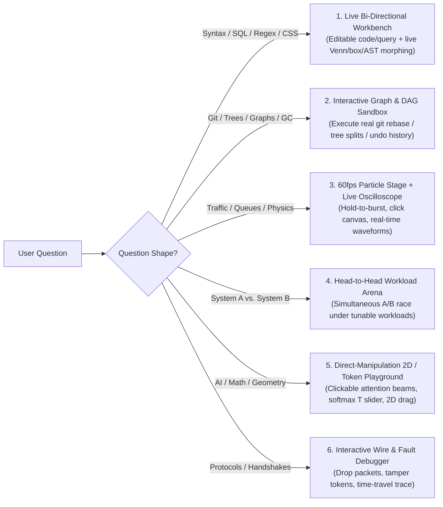

# Interactive HTML (`interactive-html`) — Deep Dive & Usage Guide

> *"Every technical question has its own natural interactive medium. Never force two different topics into the same UI shell."*

`interactive-html` is a specialized skill for AI coding agents that answers technical questions by building a **bespoke, self-contained `.html` interactive playground** ("Explorable Explanation") whose **layout topology, visual aesthetic, and interactive controls are dynamically tailored to the exact question the user asked**.

---

## Intent-Driven Adaptive Architecture (How the Skill Adapts to Your Prompt)

Instead of stamping out a single rigid template, `interactive-html` diagnoses the **conceptual shape** of your question and selects the best-fit interactive paradigm:



---

## Why This Beats Cookie-Cutter HTML Visualizers

1. **Zero Boilerplate Chrome**:
   - A `git rebase` question gets an interactive **Git Commit DAG Terminal** where you click `+ git commit`, `⚡ git rebase main`, and `🔀 git merge` and watch commit nodes clone into `C3'` with new SHA hashes.
   - An LLM question gets a **Live Token Self-Attention & Softmax Temperature Workbench** where you click words in a prompt to see weighted attention arcs and drag `Temperature (T)` / `Top-K` to reshape real token probabilities.
   - A rate-limiter question gets a **60fps Particle Physics Stream + Live Scrolling Oscilloscope**.
2. **Real Micro-Algorithms in Vanilla JS**:
   - Controls execute real domain math and state transitions in the browser—never fake text swaps.
3. **Domain-Matched Visual Personalities**:
   - Adapts between **Warm Editorial Paper (`ciechanow.ski` style)**, **Developer Terminal / Git Workbench**, **Cyber-Telemetry Command Center**, and **Blueprint CAD Studio**.

---

## How to Use `interactive-html`

### Natural Language Prompts
```text
answer me with interactive html: git rebase vs git merge
explain how transformer self-attention and temperature sampling work in interactive html
build an interactive html playground for SQL INNER vs LEFT vs FULL OUTER joins
```

### Slash Command Prompts
```text
/interactive-html git rebase vs merge
/interactive-html transformer self-attention and temperature
/interactive-html token bucket vs leaky bucket rate limiting
```

---

## Sandbox & File Hygiene

- **Zero-Build, Single-File**: Standalone `.html` file using vanilla HTML5, CSS Grid/Flexbox, inline SVG, high-DPI `<canvas>`, and vanilla ES6+ JS.
- **Offline & Sandbox Safe**: No external `fetch()` calls, web fonts, or unverified CDNs.
- **Default Output Path**: Saved under `.interactive-html/<topic-slug>.html` inside your workspace and opened automatically in your agent's Review panel.
