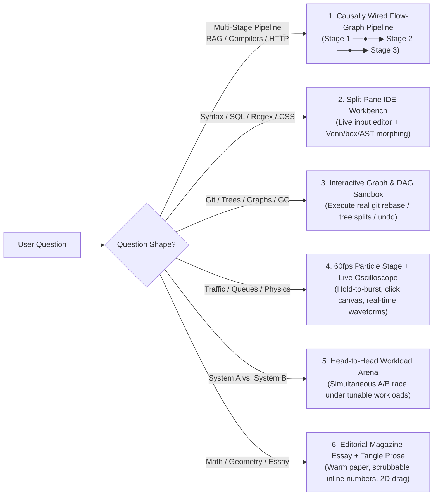

# Interactive HTML (`interactive-html`) — Deep Dive & Usage Guide

> *"Every technical question has its own natural interactive medium and macro page architecture. Never force two different topics into the same UI shell, and never build isolated widgets that don't talk to each other."*

`interactive-html` is a specialized skill for AI coding agents that answers technical questions by building a **bespoke, self-contained `.html` interactive playground** ("Explorable Explanation") whose **macro page topology, visual aesthetic, in-browser algorithm, and interactive controls are dynamically tailored to the exact question the user asked**.

---

## Intent-Driven Adaptive Architecture (How the Skill Adapts to Your Prompt)

Instead of stamping out a single rigid template, `interactive-html` diagnoses the **conceptual shape** of your question and selects both the **Interactive Paradigm** and the **Macro Page Topology**:



---

## Four Pillars of High-Craft Explorable Explanations

1. **End-to-End Causal Wiring (Zero Isolated Islands)**:
   - Every stage on the page shares a **single reactive domain state**. For example, in a RAG explainer, changing `Chunk Size` or `Overlap` in Stage 1 dynamically re-slices the knowledge base, re-plots the chunks in Stage 2's 2D Vector Map, and re-assembles the `<context>` prompt and cited LLM answer in Stage 3!
2. **Live Custom Input + Curated Presets**:
   - Whenever a topic processes queries, strings, keys, arrays, or rules, users can both click curated presets and **type their own live input** to watch the real vanilla-JS micro-algorithm evaluate it in real time.
3. **Tangle-Style Scrubbable Inline Prose**:
   - Narrative paragraphs embed draggable inline numbers (`[ 16 words ⟷ ]`) so readers can scrub parameters directly inside the text.
4. **Mandatory 5-Point Self-Refinement Gate**:
   - Before delivering the file, the agent audits Causal Connectivity, Macro Topology Diversity, Live Input Support, 60fps Retina Polish, and Sandbox Compliance.

---

## How to Use `interactive-html`

### Natural Language Prompts
```text
answer me with interactive html: what is RAG and how do chunking and vector search work together?
answer me with interactive html: git rebase vs git merge
explain how transformer self-attention and temperature sampling work in interactive html
```

### Slash Command Prompts
```text
/interactive-html rag pipeline
/interactive-html git rebase vs merge
/interactive-html token bucket vs leaky bucket rate limiting
```

---

## Sandbox & File Hygiene

- **Zero-Build, Single-File**: Standalone `.html` file using vanilla HTML5, CSS Grid/Flexbox, inline SVG, high-DPI `<canvas>`, and vanilla ES6+ JS.
- **Offline & Sandbox Safe**: No external `fetch()` calls, web fonts, or unverified CDNs.
- **Default Output Path**: Saved under `.interactive-html/<topic-slug>.html` inside your workspace and opened automatically in your agent's Review panel.
