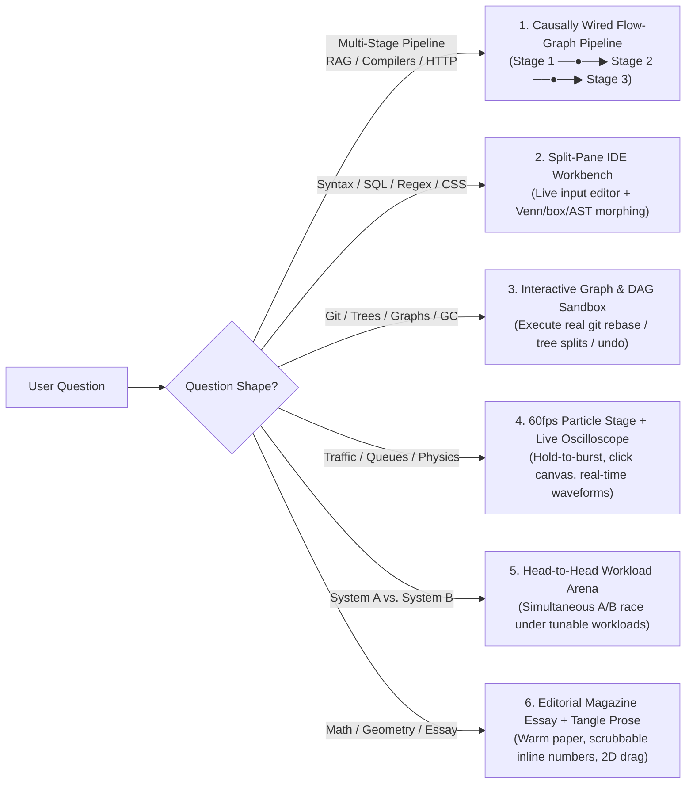

# Interactive HTML (`interactive-html`) — Deep Dive & Usage Guide

> *"Every technical question has its own natural interactive medium and macro page architecture. Never force two different topics into the same UI shell, and never build isolated widgets that don't talk to each other."*

`interactive-html` is a specialized skill for AI coding agents that answers technical questions by building a **bespoke, self-contained `.html` interactive playground** ("Explorable Explanation") whose **macro page topology, visual aesthetic, in-browser algorithm, and interactive controls are dynamically tailored to the exact question the user asked**.

---

## Intent-Driven Adaptive Architecture (How the Skill Adapts to Your Prompt)

Instead of stamping out a single rigid template, `interactive-html` diagnoses the **conceptual shape** of your question and selects both the **Interactive Paradigm** and the **Macro Page Topology**:



---

## Four Pillars of Visual-First Explorable Explanations

1. **One Spacious Focal Stage (Never 3 Cramped Columns)**:
   - Gives **85%+ of the screen** to one generous, uncluttered animated stage (`<canvas>` or `<svg>`). Never squeezes 3 side-by-side text/table columns into a narrow preview panel.
2. **Object-Permanence Motion Over Duplicate Tables**:
   - Instead of drawing a static "Input Table" on the left and a separate "Output Table" on the right, the objects themselves **physically glide, snap together like magnets, split, or drop out** on the same stage using 60fps spring physics (`F = -kx - cv`).
3. **Strict Text Diet (`<= 80 Words` of Prose)**:
   - People ask for Interactive HTML because they don't want to read walls of text. Pages are capped at one short subtitle (`<= 18 words`) and a compact 1-line live formula/status readout.
4. **Automated Acceptance Testing & 100-Point Craft Rubric**:
   - Every generated `.html` file is validated by [`skills/interactive-html/scripts/verify-html.mjs`](../skills/interactive-html/scripts/verify-html.mjs) against the **5 Hard Gates** and **100-Point Craft Rubric** in [`skills/interactive-html/references/acceptance-criteria.md`](../skills/interactive-html/references/acceptance-criteria.md) (rejecting 3-column grids, text bloat `> 85 words`, JS syntax errors, and missing Retina HiDPI scaling).

---

## How to Use `interactive-html`

### Natural Language Prompts
```text
answer me with interactive html: what is RAG and how do chunking and vector search work together?
answer me with interactive html: git rebase vs git merge
explain how transformer self-attention and temperature sampling work in interactive html
```

### Slash Command Prompts
```text
/interactive-html rag pipeline
/interactive-html git rebase vs merge
/interactive-html token bucket vs leaky bucket rate limiting
```

---

## Sandbox & File Hygiene

- **Zero-Build, Single-File**: Standalone `.html` file using vanilla HTML5, CSS Grid/Flexbox, inline SVG, high-DPI `<canvas>`, and vanilla ES6+ JS.
- **Offline & Sandbox Safe**: No external `fetch()` calls, web fonts, or unverified CDNs.
- **Default Output Path**: Saved under `.interactive-html/<topic-slug>.html` inside your workspace and opened automatically in your agent's Review panel.
