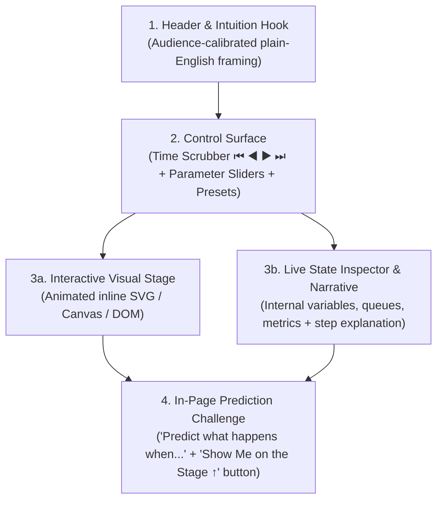

# Interactive HTML (`interactive-html`) — Deep Dive & Usage Guide

> *"Answer me with interactive HTML: turn abstract systems, algorithms, and bugs into live, manipulable simulations."*

`interactive-html` is a specialized skill for AI coding agents that answers technical questions by building a **self-contained, single-file interactive `.html` micro-application** ("Explorable Explanation") rather than dumping static chat prose.

---

## Why `interactive-html` Exists

Some engineering concepts are inherently **dynamic and multi-dimensional**:
- Watching a **B+ Tree** prune millions of rows in 3 hops vs. a linear scan.
- Stepping backward and forward through the **JavaScript Event Loop** as microtasks drain before macrotasks.
- Dragging a slider on a **Token Bucket Rate Limiter** to see the exact moment burst traffic triggers `HTTP 429`.
- Injecting a network partition into a **Raft cluster** to watch quorum election in action.

Static text and even static diagrams force the reader to simulate time and state transitions inside their own head. `interactive-html` moves that simulation onto an interactive canvas with **time scrubbers, parameter sliders, live state inspectors, and in-page prediction challenges**.

---

## When to Use `interactive-html` vs. `wtf`

| Dimension | [`wtf`](wtf.md) (Walk Through Foundations) | `interactive-html` (Answer Me With Interactive HTML) |
| :--- | :--- | :--- |
| **Best For** | Conversational Socratic coaching, step-by-step dialogue, quick mental models in chat | Hands-on visual debugging, time-scrubbing state machines, parameter tuning ("what happens if I double $N$?") |
| **Output Format** | Markdown chat turns + Mermaid/ASCII diagrams | Self-contained `.html` micro-app rendered in the live Review panel / browser |
| **Interactivity** | Chat reply gates between pieces | In-page Time Scrubber (`◀ Prev` / `▶ Play` / `Next ▶`), range sliders, scenario presets, and interactive quiz cards |

---

## The 4-Part Interactive HTML Architecture

Every generated `.html` explanation is structured around four connected components:



### 1. Reversible Time Scrubber
Every simulation exposes a deterministic `steps[]` timeline so the learner can pause, step **backward** (`←`), step **forward** (`→`), or drag the timeline slider to inspect the exact moment a state transition occurs.

### 2. Parameter Sliders & Scenario Presets
Learners don't just watch a pre-recorded animation—they can adjust system parameters (e.g., *Target Key*, *Traffic Burst Rate*, *Tree Fanout*) or click one-click presets (*"Happy Path"*, *"Cache Stampede"*, *"Split-Brain"*).

### 3. Synchronized Visual Stage & State Inspector
The visual stage (inline SVG or Canvas) is paired side-by-side with a live readout of internal variables, counters, and step-by-step commentary.

### 4. In-Page Prediction Gate
At the bottom of the page, an interactive challenge asks the learner to predict the outcome of an edge case, gives instant feedback, and offers a **"Show Me on the Stage ↑"** button that configures the simulator above to prove the answer visually.

---

## How to Use `interactive-html`

### Natural Language Prompts
```text
answer me with interactive html: how does a B+ Tree index beat a full table scan?
explain the JavaScript event loop in interactive html
build an interactive html playground for token bucket rate limiting
```

### Slash Command Prompts
```text
/interactive-html raft leader election and split brain
/interactive-html tcp congestion control like I am 10 years old
/interactive-html css flexbox vs grid alignment
```

---

## Sandbox & File Hygiene

- **Zero-Build, Single-File**: Every explainer is a standalone `.html` file using vanilla HTML5, CSS Grid/Flexbox (with automatic dark/light theme support), inline SVG/Canvas, and vanilla JS.
- **Offline & Sandbox Safe**: No external `fetch()` calls, web fonts, or unverified CDNs.
- **Default Output Path**: Unless you ask for a specific file path, files are saved under `.interactive-html/<topic-slug>.html` inside your workspace and opened automatically in your agent's preview panel.
